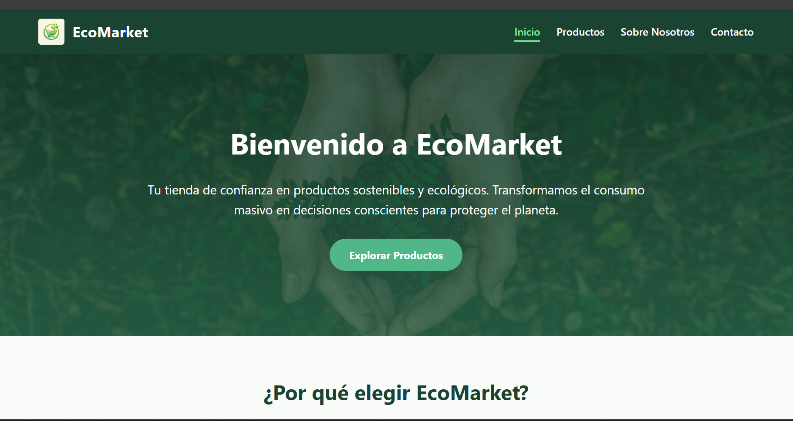
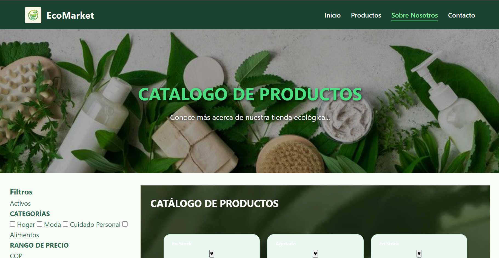
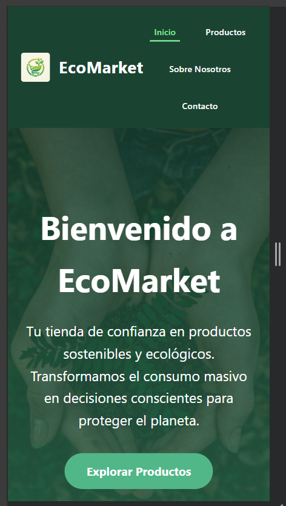
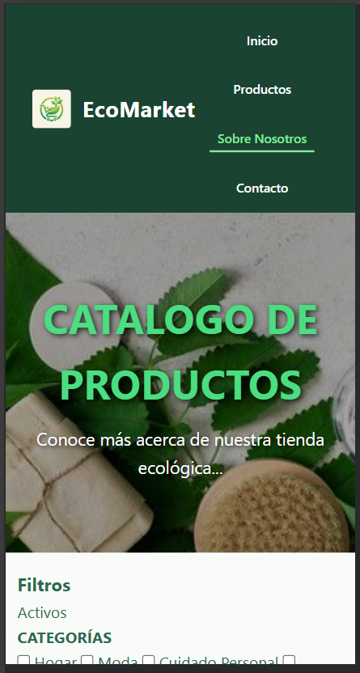
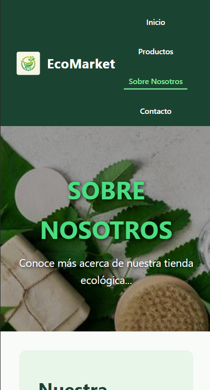
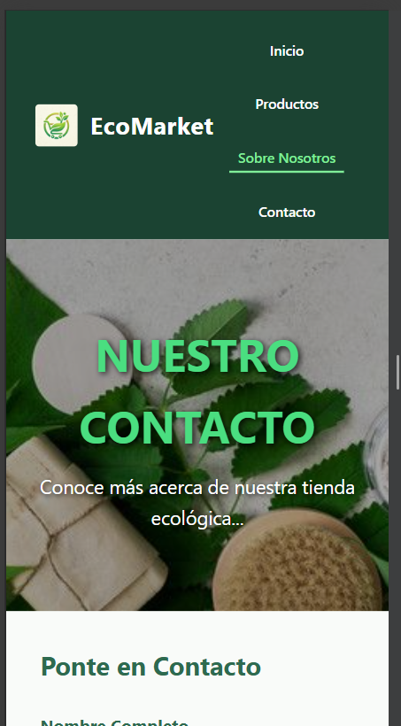

# 🌿 EcoMarket
## Tienda Online de Productos Sostenibles

**EcoMarket** es una plataforma e-commerce dedicada exclusivamente a la comercialización de productos ecológicos, reutilizables y sustentables. El proyecto está diseñado bajo una arquitectura limpia, responsiva y con una experiencia de usuario (*UX/UI Clean*) que transmite serenidad, frescura y compromiso ambiental.


---

## 📖 Descripción del Proyecto

EcoMarket busca fomentar el consumo consciente mediante una interfaz accesible y atractiva. Este proyecto pone a prueba el dominio avanzado de **HTML5 Semántico y CSS3 Puro** sin recurrir a scripts de JavaScript ni librerías externas.

### Características Clave:
* **Cero JavaScript:** Toda la interactividad (estados, efectos hover, transiciones y validaciones) se maneja de forma nativa en CSS.
* **Diseño Mobile-First:** Totalmente responsivo para adaptarse a dispositivos móviles, tablets y pantallas de escritorio.
* **Paleta Natural:** Uso estratégico de tonos verdes (`#2ecc71`, `#27ae60`) y tierras/beige (`#f5f5dc`) para reflejar identidad ecológica.

---

## 🛠️ Tecnologías Utilizadas

* **HTML5 Semántico:** Estructura limpia y accesible (`<header>`, `<main>`, `<aside>`, `<section>`, `<footer>`).
* **CSS3 Puro:**
  * **Layouts:** CSS Grid y Flexbox.
  * **Interacciones:** Pseudoclases (`:hover`, `:active`, `:valid`, `:invalid`, `:target`).
  * **Arquitectura:** Modularización de hojas de estilo (`main.css`, `layout.css`, `components.css`, `animations.css`).
* **Git & GitHub:** Control de versiones bajo metodología GitFlow y convenciones de commits (*Conventional Commits*).

---

## 📂 Estructura del Proyecto

```text
EcoMarket/
├── css/
│   ├── animations.css    # Transiciones y keyframes
│   ├── components.css    # Tarjetas, botones, inputs y elementos reutilizables
│   ├── layout.css        # Layouts, Header, Footer y contenedores Grid
│   └── main.css          # Variables globales, reset y tipografía
├── img/                  # Recursos gráficos y productos
├── video/                # Elementos audiovisuales de soporte
├── views/
│   ├── productos.html    # Catálogo con sidebar de filtros y 20 productos
│   ├── sobre-nosotros.html# Historia, principios ecológicos y testimonios
│   └── contacto.html     # Formulario inteligente, mapa y redes sociales
├── index.html            # Página de Inicio (Home)
└── README.md             
```

## 💻 Vistas Principales

* **Página de Inicio (index.html):** Banner principal con llamado a la acción (CTA), grid de 6 productos destacados e información clave de la marca.

* **Catálogo de Productos (views/productos.html):** Grid responsivo con tarjetas de productos, barra lateral (Sidebar Sticky) de filtros por categoría y precio, y barra de paginación visual.

* **Sobre Nosotros (views/sobre-nosotros.html):** Sección descriptiva del origen de la plataforma, principios ecológicos y carrusel visual de testimonios.

* **Contacto (views/contacto.html):** Formulario con validación visual nativa en CSS (:valid / :invalid), ubicación estática estilizada y redes sociales animadas.

#  📸 Capturas de Pantalla

## 💻 Vista de Escritorio (Desktop)

**Portada Principal**
<p align="center">
  
</p>

**Pagina Catalogo** 
<p align="center">
  
</p> 

**Pagina Sobre Nosotros**
<p align="center">
  
</p>

**Pagina Contacto**
<p align="center">
  
</p>

## Vista Móvil (Mobile-First)

**Portada Principal**
<p align="center">
  
</p> 


**Pagina Catalogo** 
<p align="center">
  
</p> 

**Pagina Sobre Nosotros**
<p align="center">
  
</p>

**Pagina Contacto**
<p align="center">
  
</p>


## 🚀 Instrucciones de Visualización
* Ejecución Local
Clona el repositorio desde GitHub: Bash
git clone [https://github.com/jasminsofi/EcoMarket](https://github.com/jasminsofi/EcoMarket)
* Entra a la carpeta del proyecto: Bash
cd EcoMarket
Abre el archivo index.html directamente en tu navegador o utiliza la extensión Live Server en Visual Studio Code.

* 🌿 Metodología de Trabajo y Git
El desarrollo del proyecto se realizó implementando GitFlow, trabajando en ramas independientes (main, feature/catalogo, feature/contacto) y aplicando la convención Conventional Commits (feat:, fix:, docs:).

🌐 Despliegue
La plataforma se encuentra desplegada y disponible para su consulta en el siguiente enlace:

🔗 Ver Sitio Web de EcoMarket
https://jasminsofi.github.io/EcoMarket/index.html

